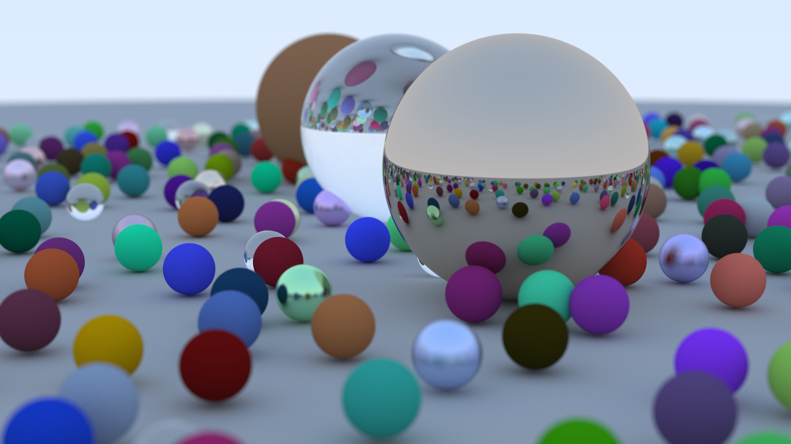

# Ray Tracer in C++

A CPU path tracer written in C++, following [*Ray Tracing in One Weekend*](https://raytracing.github.io/books/RayTracingInOneWeekend.html) by Peter Shirley, Trevor David Black, and Steve Hollasch.



## Features

- Path tracing with a configurable bounce depth
- Antialiasing with jittered sub-pixel sampling
- Lambertian and metal (adjustable fuzz) materials
- Gamma correction
- Positionable camera with adjustable field of view
- Depth of field (defocus blur)
- PPM image output, no external dependencies

## Build and run

```bash
g++ -O3 -o raytracer main.cc
./raytracer > image.ppm
```

## Configuration

The scene and camera are set in `main.cc`:

```cpp
cam.aspect_ratio      = 16.0 / 9.0;
cam.image_width       = 400;
cam.samples_per_pixel = 100;
cam.max_depth         = 50;

cam.vfov     = 20;
cam.lookfrom = point3(-2, 2, 1);
cam.lookat   = point3(0, 0, -1);
cam.vup      = vec3(0, 1, 0);

cam.defocus_angle = 10.0;  // 0 = no blur
cam.focus_dist    = 3.4;   // distance to the plane of perfect focus
```

## Credits

Based on *Ray Tracing in One Weekend* (<https://raytracing.github.io/>), released under CC0.
